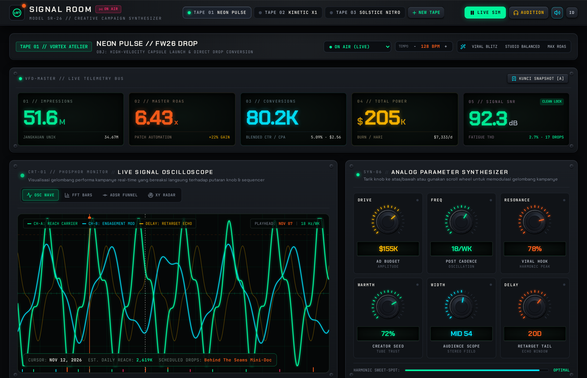
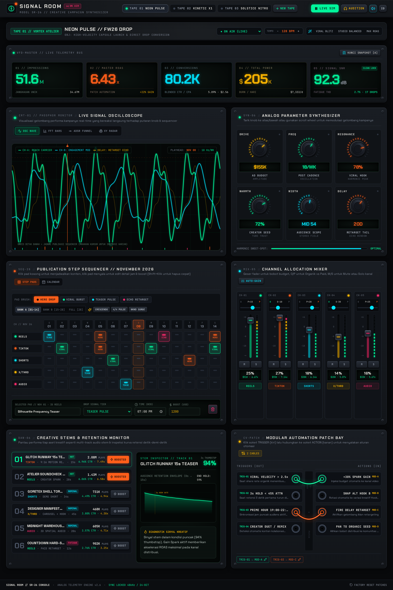
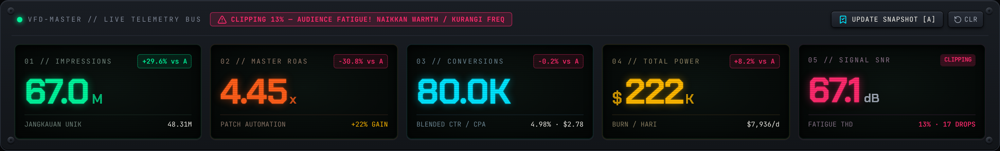
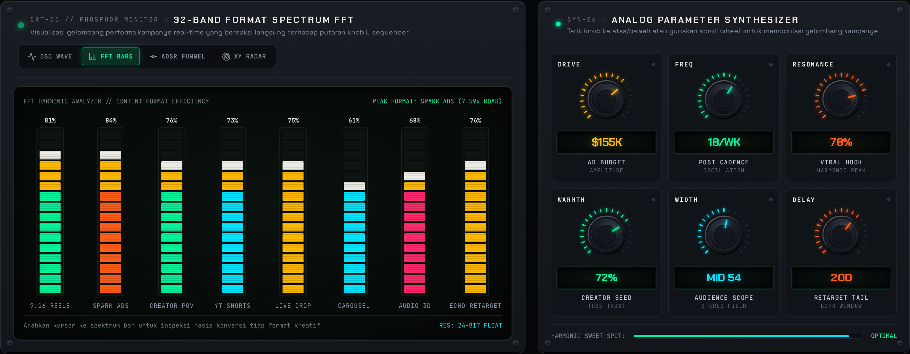
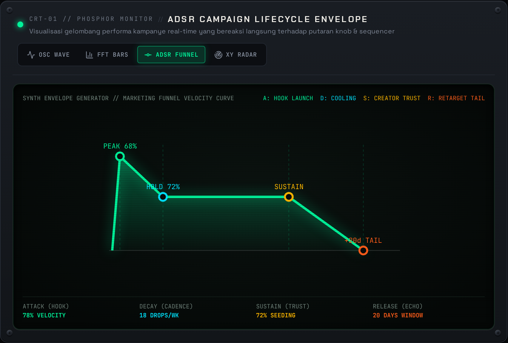
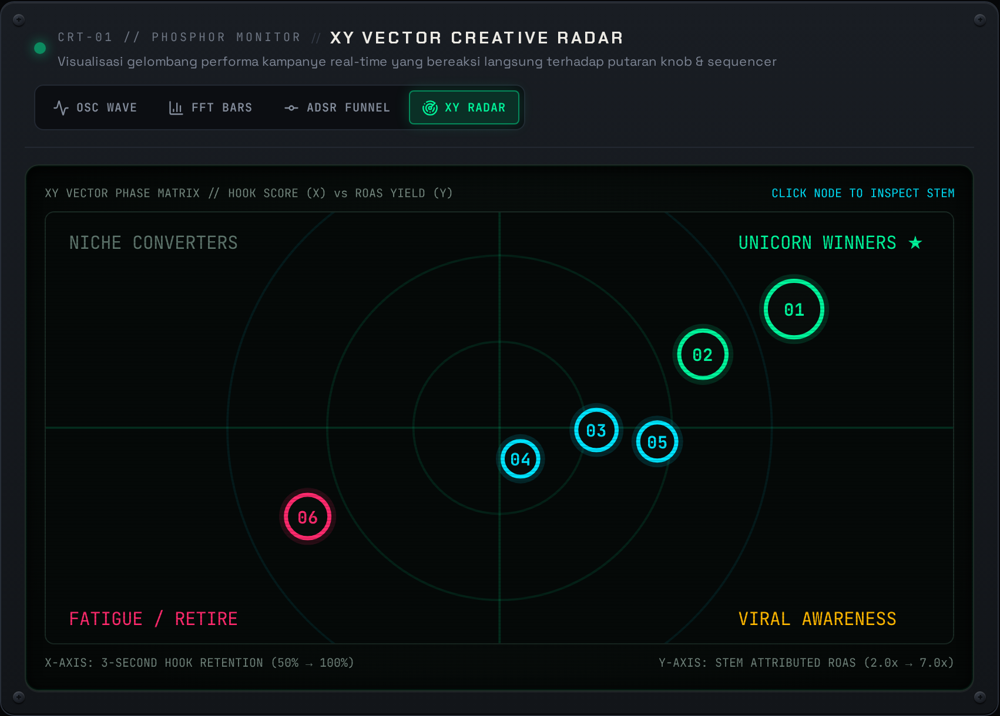
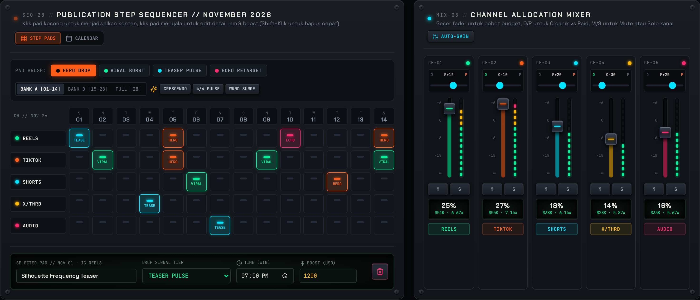
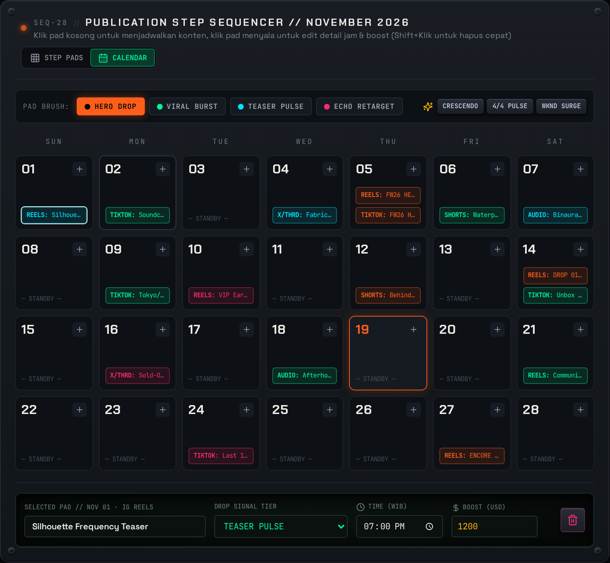
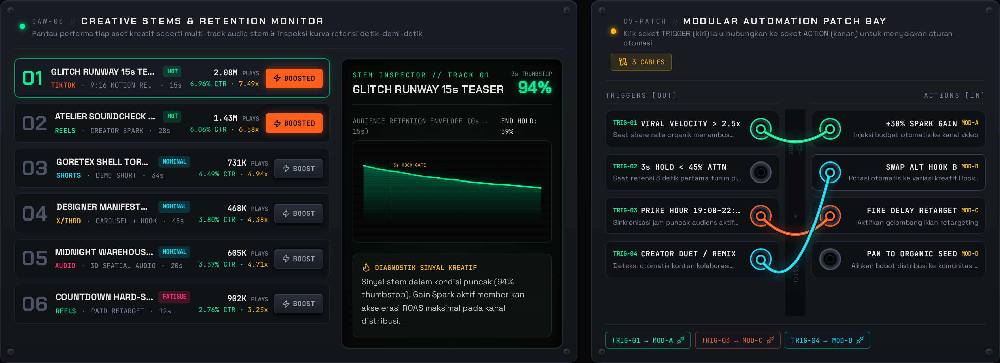
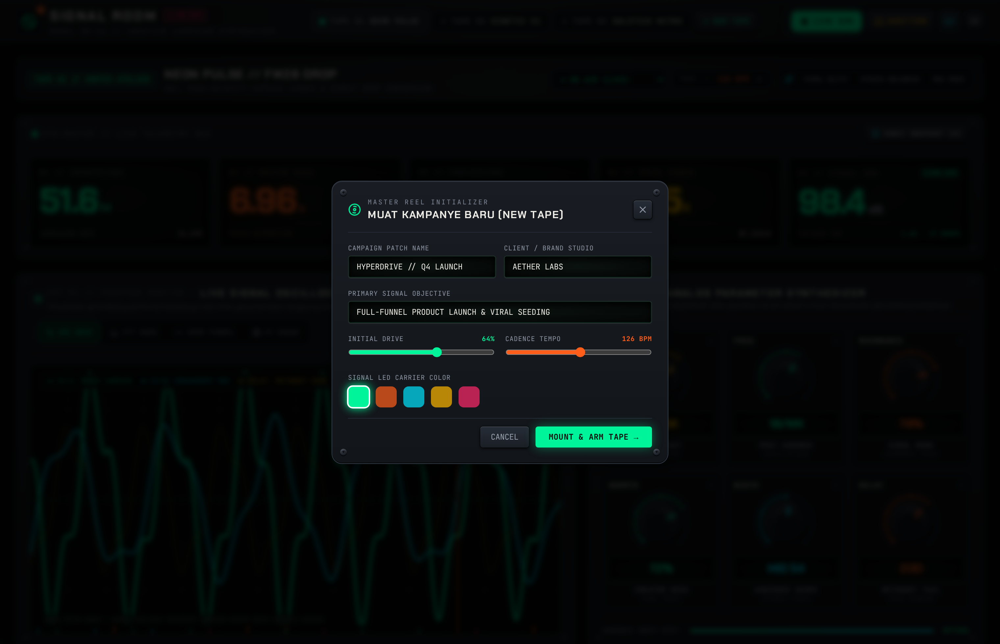

<div align="center">

# SIGNAL ROOM
### Creative Campaign Control Center · Model SR-26

**Studio analog untuk merancang, menyusun, dan memantau kampanye digital.**  
Bukan dashboard marketing generik: setiap kanal jadi channel mixer, setiap publikasi jadi step sequencer, dan setiap kampanye dimainkan seperti sebuah master tape.


</div>

---

## Sekilas

SIGNAL ROOM adalah **frontend interaktif** untuk perencanaan dan simulasi performa kampanye kreatif. Antarmukanya mengambil bahasa visual dari konsol mixing analog, synthesizer modular, VFD, dan monitor CRT: faceplate metal gelap, sekrup rack, lampu status, gelombang fosfor, angka besar, serta aksen neon.

> **Catatan data:** metrik dan performa di aplikasi merupakan simulasi lokal untuk demonstrasi konsep; aplikasi tidak terhubung ke akun iklan, platform sosial, atau API analitik eksternal.

## Galeri tangkapan layar

Semua gambar di bawah adalah tangkapan layar **Retina 2×**. Klik gambar untuk membuka resolusi penuhnya.

<table>
  <tr>
    <td width="50%" align="center">
      <a href="./docs/screenshots/01-hero-console.png"></a><br>
      <strong>01 · Hero console</strong><br><sub>Telemetry utama, osiloskop live, dan enam knob analog.</sub>
    </td>
    <td width="50%" align="center">
      <a href="./docs/screenshots/02-full-studio-rack.png"></a><br>
      <strong>02 · Full studio rack</strong><br><sub>Ikhtisar seluruh console dan modul kampanye dalam satu tampilan.</sub>
    </td>
  </tr>
  <tr>
    <td width="50%" align="center">
      <a href="./docs/screenshots/03-vfd-snapshot-clipping.png"></a><br>
      <strong>03 · VFD snapshot & clipping</strong><br><sub>Perbandingan snapshot A/B serta peringatan audience-fatigue clipping.</sub>
    </td>
    <td width="50%" align="center">
      <a href="./docs/screenshots/04-crt-fft-spectrum.png"></a><br>
      <strong>04 · CRT — FFT spectrum</strong><br><sub>Analyzer efisiensi format kreatif dengan bar spektrum.</sub>
    </td>
  </tr>
  <tr>
    <td width="50%" align="center">
      <a href="./docs/screenshots/05-crt-adsr-funnel.png"></a><br>
      <strong>05 · CRT — ADSR funnel</strong><br><sub>Kurva Attack, Decay, Sustain, dan Release untuk lifecycle kampanye.</sub>
    </td>
    <td width="50%" align="center">
      <a href="./docs/screenshots/06-crt-xy-radar.png"></a><br>
      <strong>06 · CRT — XY radar</strong><br><sub>Matriks hook score dan ROAS; klik node untuk memilih stem.</sub>
    </td>
  </tr>
  <tr>
    <td width="50%" align="center">
      <a href="./docs/screenshots/07-step-sequencer-mixer.png"></a><br>
      <strong>07 · Step sequencer & channel mixer</strong><br><sub>Penjadwalan drop dan pengaturan alokasi lima kanal.</sub>
    </td>
    <td width="50%" align="center">
      <a href="./docs/screenshots/08-monthly-calendar-view.png"></a><br>
      <strong>08 · Kalender publikasi</strong><br><sub>Jadwal kampanye dalam kalender studio 28 hari.</sub>
    </td>
  </tr>
  <tr>
    <td width="50%" align="center">
      <a href="./docs/screenshots/09-stems-eurorack-patchbay.png"></a><br>
      <strong>09 · Creative stems & Eurorack patch bay</strong><br><sub>Inspeksi retensi konten dan koneksi otomasi modular.</sub>
    </td>
    <td width="50%" align="center">
      <a href="./docs/screenshots/10-new-campaign-modal.png"></a><br>
      <strong>10 · New campaign</strong><br><sub>Form pembuat kampanye: brand, objective, drive, BPM, dan warna sinyal.</sub>
    </td>
  </tr>
</table>

## Fitur utama

| Modul | Kemampuan |
|---|---|
| **Campaign tape deck** | Beralih di antara beberapa kampanye, mengatur status siaran, tempo/BPM, dan membuat tape kampanye baru. |
| **VFD telemetry bus** | Membaca impressions, ROAS, conversions, power budget, SNR, serta indikator fatigue/clipping. Simpan snapshot **A/B** untuk membandingkan perubahan strategi. |
| **Analog synthesizer · SYN-06** | Enam kontrol kampanye: `DRIVE`, `FREQ`, `RESONANCE`, `WARMTH`, `WIDTH`, dan `DELAY`. Putar dengan drag, scroll wheel, tombol panah, atau klik ganda untuk reset. |
| **CRT visualizer · CRT-01** | Empat visualisasi: live `OSC WAVE`, `FFT BARS`, `ADSR FUNNEL`, dan `XY RADAR`. Gelombang merespons parameter synth dan jadwal publikasi. |
| **Channel mixer · MIX-05** | Lima fader alokasi kanal, meter VU LED, trim organik/paid, tombol mute/solo, serta auto-gain. |
| **Sequencer & calendar · SEQ-28** | Susun jadwal di step pads 5 × 28 hari atau kalender 28 hari. Pilih tier drop (`HERO DROP`, `VIRAL BURST`, `TEASER PULSE`, `ECHO RETARGET`) dan preset ritme. |
| **Creative stems · DAW-06** | Bandingkan aset kreatif, CTR, ROAS, plays, skor thumbstop, dan kurva retensi. Pilih stem untuk inspeksi atau aktifkan boost. |
| **Automation patch bay · CV-PATCH** | Hubungkan trigger dan action dengan kabel patch SVG bergaya modular untuk mensimulasikan aturan otomasi. |
| **Studio controls** | Efek klik taktil berbasis Web Audio, audition synthesizer, toggle bahasa Indonesia/Inggris, dan factory reset. |

## Cara kerja simulasi

```text
Campaign Patch + parameter synth
                 │
                 ▼
    computeTelemetry(campaign)
                 │
       ┌─────────┴──────────┐
       ▼                    ▼
  VFD / ROAS          CRT & kanal mixer
       │                    │
       └────── sequencer ────┘
              + creative stems
```

Perubahan knob dan kontrol memperbarui state kampanye, lalu engine telemetry menghitung ulang angka serta visualisasi. Data kampanye tersimpan di `localStorage` browser dengan key `signal_room_campaigns_v1`; tidak membutuhkan backend untuk demo ini.

## Teknologi

- **React 18** + **TypeScript 5**
- **Vite 6** untuk development dan production build
- **Tailwind CSS 3** untuk styling
- **Lucide React** untuk ikon
- **Canvas API** untuk osiloskop real-time; **SVG** untuk kurva, indikator, dan kabel patch
- **Web Audio API** untuk bunyi kontrol sintetis tanpa aset audio eksternal
- **localStorage** untuk persistensi kampanye di browser

## Menjalankan secara lokal

**Prasyarat:** Node.js 20+ dan npm.

```bash
# Clone repository
git clone https://github.com/rilians/signal-room.git
cd signal-room

# Install dependency
npm install

# Jalankan development server
npm run dev
```

Buka URL lokal yang ditampilkan Vite (secara default `http://localhost:5173`). Untuk memeriksa production build:

```bash
npm run build
npm run preview
```

## Struktur proyek

```text
signal-room/
├── docs/
│   └── screenshots/       # 10 tangkapan layar Retina 2× untuk dokumentasi
├── src/
│   ├── components/        # Modul console, CRT, mixer, sequencer, stems, patch bay
│   ├── data/              # Kampanye awal dan kalkulasi telemetry
│   ├── types/             # Tipe TypeScript untuk campaign patch
│   ├── utils/             # Web Audio sound engine
│   ├── App.tsx            # State, layout, persistensi, dan kontrol utama
│   ├── index.css          # Faceplate, CRT, VFD, dan gaya studio
│   └── main.tsx           # Entry point React
├── index.html
├── package.json
├── tailwind.config.js
└── vite.config.ts
```

## Build production

```bash
npm run build
```

Vite menghasilkan file statis ke `dist/`. Folder build, cache, dependency, dan file environment lokal tidak disertakan ke Git.

## Deploy ke Vercel

Proyek dikonfigurasi untuk **Vite** dengan perintah build `npm run build` dan output `dist/`. Untuk deploy dari repository atau terminal:

```bash
npm install --global vercel
vercel login
vercel link
vercel --prod
```

Pilih project `signal-room` saat proses link, atau impor repository ini dari dashboard Vercel. Tidak ada environment variable khusus yang dibutuhkan.
